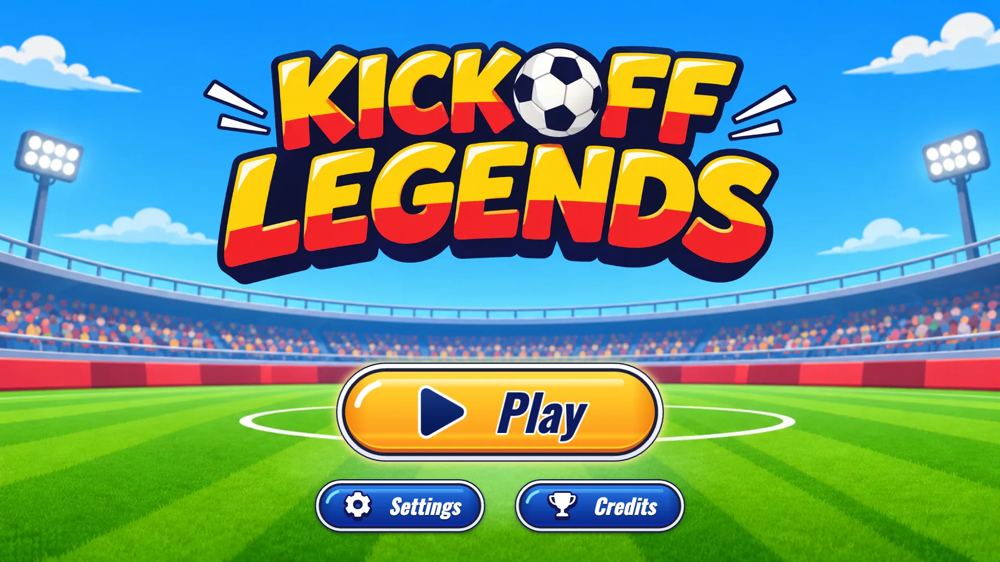
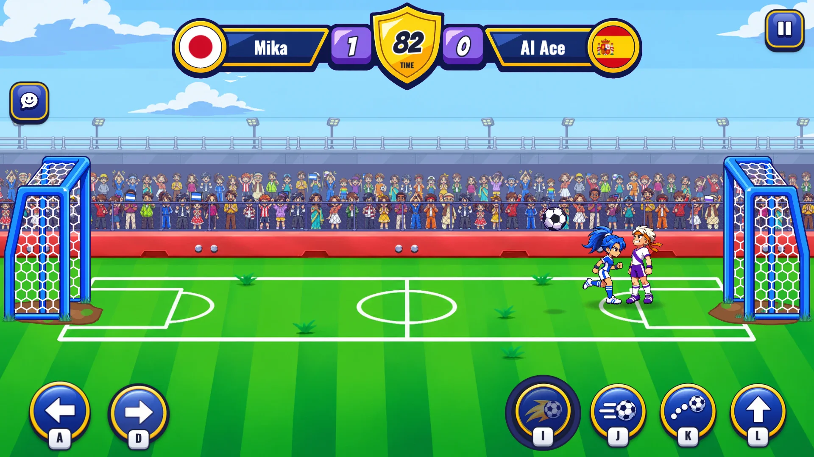
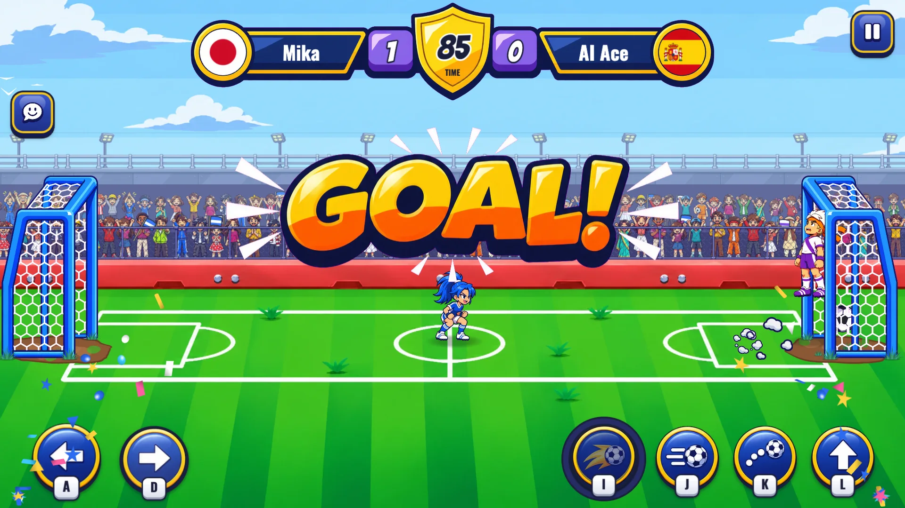

# Kickoff Legends

A cel-shaded 1v1 arcade football game for the browser.

| Home | Pick your legend |
| :-: | :-: |
|  |  |
| **Match** | **Goal!** |
|  |  |

## Play

Open `index.html` in a browser, or serve the folder (for example `python3 -m http.server 5173`) and go to <http://localhost:5173>.
Works 100% offline on desktop, phone and tablet (landscape): nothing to install, no network needed.

| Action             | Key   |
| ------------------ | ----- |
| Move               | A / D |
| Jump               | L     |
| Straight kick      | J     |
| Long kick / Header | K     |
| Super skill        | I     |
| Sprint (hold)      | Shift |
| Pause              | Esc   |

On phones and tablets, use the on-screen buttons.

## Features

- 4 legends to pick from
- 90-second matches, with sudden death if it's a draw
- Driven shots, long balls, headers, sprint and a fireball Super Skill
- An AI rival that plays differently every match
- Day and night stadiums with a cheering crowd
- Reactions to tease your rival
- English and Hindi

## Stack & tech

### Built with

- Phaser 3 + plain HTML, CSS and JavaScript (no build step)
- WebAudio: all music and sound made in code
- Node + sharp: sprite atlas pipeline
- Python (NumPy, SciPy, Pillow): steadies the character animations
- Playwright and `node:test` for testing
- Art generated with ChatGPT

### Made to feel smooth

- Physics runs at your screen's refresh rate (60, 120 or 144 Hz)
- Lowers render resolution on its own if a device can't keep up
- Snappy kicks (~67 ms) and buffered inputs, so no press is lost
- Real ball spin, swerve and bounce, slowed a little for an arcade float
- Squash and stretch, hit-stop and slow-motion goals
- Steady animations: no sliding feet or shaking heads
- Everything loads before "Tap to start", so nothing pops in; served over the web, the art starts downloading the moment the engine arrives, and each image goes to the GPU once
- Sharp on high-resolution screens
- Pauses when you switch away

## For developers

The game itself needs nothing installed. The tools in `tools/` are plain Node and Python scripts:

| Task | Command |
| ---- | ------- |
| Tests | `node --test tests/*.test.mjs` |
| Rebuild `locales/locales.js` after editing `locales.json` | `node tools/make-locales.mjs` |
| Rebuild all art from `assets/source/` (raw art, kept locally) | `node tools/slice-sheet.mjs` (`--preview` for contact sheets in `tools/.preview/`) |
| Controller buttons / home-screen icons | `node tools/make-pad.mjs` · `node tools/make-icons.mjs` |
| Check the character animations | `python3 tools/sprite-qa.py` |

The art tools need `sharp` (`npm install --no-save --no-package-lock sharp@0.33.5`, which only creates the git-ignored `node_modules/`) and Python 3 with NumPy, SciPy and Pillow.

## Credits

Made by Shresth Kasera ([LinkedIn](https://www.linkedin.com/in/shresth-kasera/), [GitHub](https://github.com/shresth20/)). Engine: Phaser 3 (MIT). Fonts: Bangers, Oswald and Teko (SIL Open Font License).
