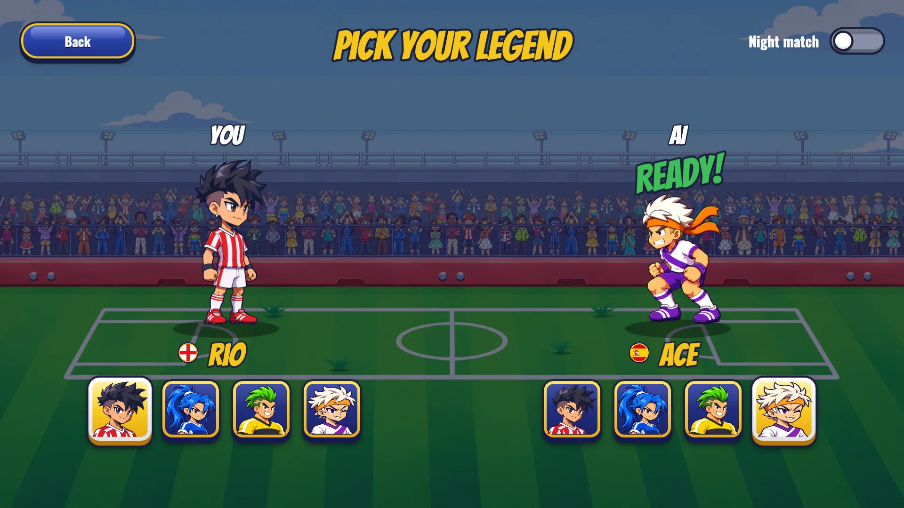

# Kickoff Legends

A cel-shaded 1v1 arcade football game for the browser. Pick a legend and beat the CPU in 90 seconds.

| Home | Pick your legend |
| :-: | :-: |
|  |  |
| **Match** | **Goal!** |
|  |  |

## Play

Open `index.html` in a browser, or run `npm run serve` and go to <http://localhost:5173>.
Works offline on desktop, phone and tablet (landscape).

| Action             | Key   |
| ------------------ | ----- |
| Move               | A / D |
| Jump               | L     |
| Straight kick      | J     |
| Long kick / Header | K     |
| Super skill        | I     |
| Sprint (hold)      | Shift |
| Pause              | Esc   |

On phones and tablets, use the on-screen buttons.

## Features

- 4 legends to pick from
- 90-second matches, with sudden death if it's a draw
- Driven shots, long balls, headers, sprint and a fireball Super Skill
- A CPU rival that plays differently every match
- Day and night stadiums with a cheering crowd
- Reactions to tease your rival
- Full screen on phones and tablets, with no black bars
- English and Hindi

## Stack & tech

### Built with

- Phaser 3 + plain HTML, CSS and JavaScript (no build step)
- WebAudio: all music and sound made in code
- Node + sharp: sprite atlas pipeline
- Python (NumPy, SciPy, Pillow): steadies the character animations
- Playwright and `node:test` for testing
- Art generated with ChatGPT

### Made to feel smooth

- Physics runs at your screen's refresh rate (60, 120 or 144 Hz)
- Lowers render resolution on its own if a device can't keep up
- Snappy kicks (~67 ms) and buffered inputs, so no press is lost
- Real ball spin, swerve and bounce, slowed a little for an arcade float
- Squash and stretch, hit-stop and slow-motion goals
- Steady animations: no sliding feet or shaking heads
- Everything loads before "Tap to start", so nothing pops in
- Sharp on high-resolution screens
- Pauses when you switch away

## Credits

Made by Shresth Kasera ([LinkedIn](https://www.linkedin.com/in/shresth-kasera/), [GitHub](https://github.com/shresth20/)). Engine: Phaser 3 (MIT). Fonts: Bangers, Oswald and Teko (SIL Open Font License).
